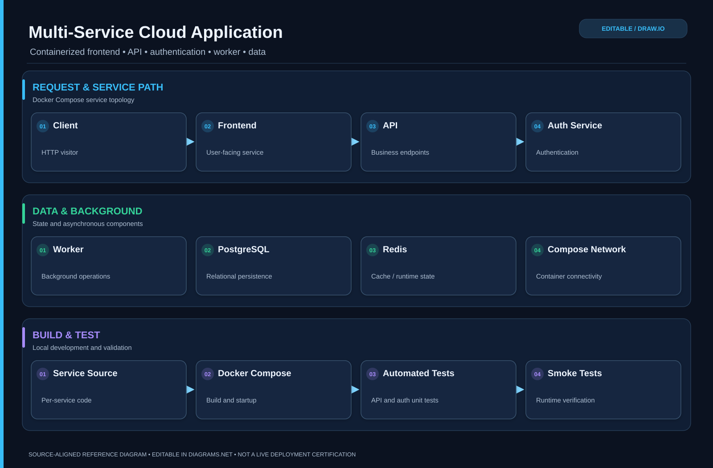

# Cloud Platform Application

<!-- drawio:architecture:start -->
### Editable architecture diagram

[Open and edit in draw.io](docs/architecture/architecture.drawio) · [View full-size SVG](docs/architecture/architecture.svg)

*This diagram is based on this repository's documented design and source code; refer to the project status above for deployed-versus-reference details.*

<!-- drawio:architecture:end -->

Multi-service application: frontend, API, auth, worker, PostgreSQL, Redis.

Run: `docker compose up --build` then open http://localhost:8080
